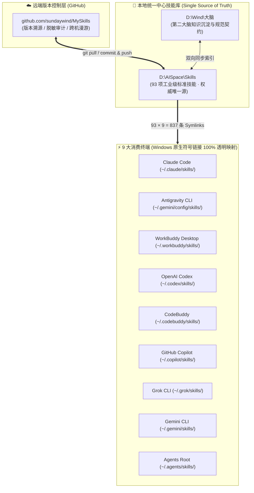

# 🌟 MySkills — AI Agent 统一中心技能库 (Central Skills Hub)

> **单一事实源 (Single Source of Truth)** · **一处维护，全机 9 大 AI Agent 秒级同步**

本仓库（本地挂载路径：`D:\AISpace\Skills`）是个人跨终端 AI 智能体（CLI & Desktop APP）的**工业级统一技能中心库**。通过将分散在各工具中的技能进行去重优选、规范化重构，并通过操作系统原生符号链接（Symlink）全量映射至 9 大主流 Agent 终端，实现全机能力的集中版本控制与跨设备无缝漫游。

---

## 🗺️ 全局架构拓扑

---

## 📚 核心技能生态矩阵（7 大领域 · 93 项技能）

### 🎬 一、短视频与多媒体工业化生产（25 项）

| 技能目录 (Skill ID) | 核心能力简述 |
| :--- | :--- |
| `jianying-editor` | **剪映专业版 AI 全自动剪辑底座 (`JyWrapper`)**：直接读写 `draft_info.json`，支持素材导入、AI 配音、字幕对齐与导出 |
| `auto-video-editor` | **全自动短视频与口播剪辑流水线**：9:16 竖屏自适应、TTS 配音、双语字幕毫秒对齐、语义分镜匹配与无损拼接 |
| `workbuddy-chat-cut` | **WorkBuddy 连接 ChatCut 剪辑内核**：自然语言驱动轨道编排、片段剪切、配音配乐、转场动效与导出 |
| `chatcut-video-gen` | **AI 视频生成扩展**：集成 Seedance、Kling、Gemini Omni、MiniMax H3/H3 Max 文/图生视频与首尾帧过渡 |
| `chatcut-digital-human` | **AI 数字人与照片开口说话**：通过脚本文本或音频驱动静态人像/虚拟人生成逼真口播视频 |
| `chatcut-image-gen` | **AI 图像生成与参考图编辑**：基于 GPT Image 2.5 / GPT Image 2 / Nano Banana 生成与编辑高保真视觉资产 |
| `chatcut-image-gen-codex` | **Codex 会话专用图像生成**：专为 OpenAI Codex 环境优化的图像生成与项目资产推送通道 |
| `chatcut-voice` | **定制语音合成与声纹克隆 (TTS)**：文本转高表现力语音、声纹克隆、口误局部修复与自定义音效生成 |
| `chatcut-voice-isolation` | **AI 人声分离与背景降噪**：基于 MossFormer2 消除风噪、底噪与室内混响，提取纯净贴耳人声 |
| `chatcut-lipsync` | **口型同步与唇形驱动 (LipSync)**：将现有视频中的人物嘴型精准贴合至新配音音频 |
| `chatcut-video-translation` | **多语言视频译制与配音**：跨语言视频翻译、声纹保留配音与可选唇形同步本地化 |
| `chatcut-transcription` | **高精语音转写与智能字幕**：ASR 语音识别、专业术语校对、双语字幕排版与动态花字样式 |
| `chatcut-multicam-sync` | **多机位音视频自动对齐**：多机位画面与独立录音笔音频波形同步，自动生成主讲人切镜草稿 |
| `chatcut-music` | **AI 智能配乐与歌曲生成**：按情绪与节奏生成纯音乐 BGM 或带人声的主题曲 |
| `chatcut-audio-processing-gen` | **Web Audio 音频效果器与过渡**：自定义 EQ、动态滤波、混响、延迟与创意交叉淡化 |
| `chatcut-create-motion-graphics` | **Motion Graphics 动态图形制作**：手写或生成 HTML / Remotion 动态标题、数据动效与字幕条 |
| `chatcut-pixel-processing-gen` | **像素级视觉特效与滤镜转场**：编写 Flux/Blink HTML 着色器，实现蒙版、胶片颗粒、调色与章节转场 |
| `chatcut-talking-head-guide` | **口播与访谈视频专业剪辑法则**：去口癖、气口裁剪、节奏对齐、B-roll 插入与字幕安全区保护 |
| `chatcut-app-promo-guide` | **软件 / SaaS 产品宣传片制作指南**：结合 Motion Graphics 与 AI 视频打造高转化软件演示短片 |
| `chatcut-ugc-ad-guide` | **实体电商 UGC 带货视频生成**：自动提取商品卖点、撰写痛点转化脚本并生成电商带货短视频 |
| `chatcut-visual-analysis` | **视频帧比对与视觉质检**：逐帧比对画面变化、排查黑帧/跳帧并生成 Contact Sheet 接触印张 |
| `chatcut-web-browser` | **短视频素材与品牌资产网页采集**：基于 Firecrawl 抓取网页高清主图、视频流与品牌设计规范 |
| `chatcut-widget-forms` | **交互式剪辑表单与风格预览卡片**：在对话流中构建画幅选择、音色试听与字幕样式预览表单 |
| `chatcut-skill-creator` | **剪辑工作流技能固化器**：将跑通的复杂视频剪辑流水线提炼打包为可复用的专属 Skill |
| `chatcut-product-help` | **ChatCut 官方文档与排障助手**：查询最新功能说明、算力额度、版本要求与异常排障指南 |

### 🎭 二、AI 短剧/漫剧工业流水线与 HyperFrames 代码动画（17 项）

| 技能目录 (Skill ID) | 核心能力简述 |
| :--- | :--- |
| `novel-outline` | **短剧改编大纲五件套**：改编说明、人物表、爽点密度表、分集梗概与资产清单（含 14 道确定性质量门） |
| `novel-characters` | **小说角色拆解与设定卡**：提取人物画像、音色提示词及“左半身像+右全身三视图”标准版面指令 |
| `novel-art` | **短剧美术设定集（场景+道具）**：跨集一致性锚点、光照时段变体、空景与白底道具提示词（10 道质量门） |
| `novel-script` | **短剧结构化分集剧本**：场次与动作节拍/台词交替流，按语速确定性折算时长（10 道质量门） |
| `novel-storyboard` | **短剧三层分镜与 H3 投产包**：段(≤15s) → 分镜(2-5s) → 关键帧，自动推导 MiniMax H3 提示词与配音对齐单 |
| `character-refs` | **角色多视角参考图与定妆照真出图**：以正面全身照为唯一锚点派生大头照、侧面、背面与 45° 定妆照 |
| `hyperframes` | **HyperFrames 动态视频框架总入口**：基于 HTML/CSS/GSAP 的代码级确定性视频渲染工作流中枢 |
| `hyperframes-core` | **HyperFrames 核心合成契约**：定义 `data-*` 时间属性、clip 轨道结构、子合成与寻帧确定性规范 |
| `hyperframes-animation` | **HyperFrames 动效蓝图与运行时适配器**：涵盖 GSAP、Three.js、Lottie、Anime.js 及 24 种文字动效 |
| `hyperframes-keyframes` | **HyperFrames 运镜与关键帧变换**：推拉摇移镜头、Ken Burns 漫游、SVG 路径形变与 3D 景深控制 |
| `hyperframes-audio` | **HyperFrames 音频混音与自动化包络**：多轨混音、旁白避让压音 (Voiceover Carve) 与音频效果链 |
| `hyperframes-creative` | **HyperFrames 视觉美术与风格指导**：配色方案、字体排版、网格安全区与音乐节拍视觉映射 |
| `hyperframes-registry` | **HyperFrames 400+ 官方组件注册表**：检索并集成现成的 CRT 扫描线、故障特效、终端窗口等动效块 |
| `hyperframes-studio` | **HyperFrames 演播室时间线编排规范**：分镜规划、单元素单轨道原则与字幕安全区布局 |
| `hyperframes-cli` | **HyperFrames CLI 编译预览与云渲染**：工程初始化、帧快照对比、本地预览与无头浏览器批量渲染 |
| `general-video` | **通用多场景自由视频合成**：面向品牌混剪、快闪宣传片、静态循环背景的自由编排工作流 |
| `media-use` | **Agent 多媒体资产操作系统**：一键检索解析 BGM、音效 SFX、Logo、LUT 调色并维护本地资产账本 |

### 💻 三、软件工程、架构设计与代码质量（18 项）

| 技能目录 (Skill ID) | 核心能力简述 |
| :--- | :--- |
| `code-review` | **双轨并行代码审查**：双子 Agent 并行核验“团队编码规范 (Standards)”与“需求文档契约 (Spec)” |
| `codebase-design` | **深模块设计与架构缝隙定位**：基于《软件设计的哲学》指导高内聚、深接口模块设计与重构 |
| `improve-codebase-architecture` | **代码库架构演进与技术债治理**：扫描代码异味、循环依赖与浅模块，输出渐进式重构方案 |
| `domain-modeling` | **领域驱动设计 (DDD) 与通用语言**：提炼核心实体、聚合根、领域边界并沉淀 ADR 架构决策记录 |
| `diagnosing-bugs` | **疑难 Bug 与性能回退诊断闭环**：基于科学假设-验证循环排查崩溃堆栈、OOM 内存泄漏与死锁 |
| `tdd` | **测试驱动开发 (Red-Green-Refactor)**：严格执行“先写失败测试 → 最小实现 → 绿灯重构”闭环 |
| `check-work` | **代码变更独立子代理自检**：拉起独立验证 Agent 执行编译构建、测试运行与 diff 逐行核验 |
| `resolving-merge-conflicts` | **Git 合并与变基冲突智能消解**：分析 merge-base 双侧业务意图，安全消解代码冲突 |
| `prototype` | **抛弃型最小原型快速验证 (PoC)**：以最小成本构建交互或状态模型原型以验证设计假设 |
| `research` | **一手权威信源深度技术调研**：穿透官方文档、源码与 RFC 规范，沉淀结构化 Markdown 报告 |
| `to-spec` | **业务诉求转工程规范文档 (Spec)**：将口语化需求转化为含接口契约与边界处理的严密技术规范 |
| `to-tickets` | **技术规范转敏捷原子工单**：将 Spec 拆解为独立可交付的开发任务单并梳理依赖拓扑 |
| `triage` | **缺陷与工单智能分诊分级**：对 Issue 进行根因定位、严重度分级 (P0-P3) 与模块指派 |
| `implement` | **计划轨道自动化实施**：严格按既定 Track Plan 逐步落地代码编写与单元验证 |
| `create-skill` | **标准 Skill 脚手架交互式生成**：引导创建符合规范的 `SKILL.md`、元数据与辅助脚本目录 |
| `teach` | **苏格拉底式渐进代码教学**：通过心智模型比喻与实战任务引导掌握底层技术原理 |
| `self-improvement` | **智能体错题复盘与分层记忆演进**：在排障或纠错后自动提炼经验并固化至 HOT/WARM/COLD 记忆层 |
| `codex-primary-runtime` | **Codex 主运行时环境契约**：规范 OpenAI Codex CLI 环境下的标准执行与生命周期管理 |

### 🤖 四、浏览器控制、系统交互与桌面 RPA（8 项）

| 技能目录 (Skill ID) | 核心能力简述 |
| :--- | :--- |
| `ego-browser` | **Ego Lite 人机共生多 Agent 并行浏览器**：支持 `taskSpace` 多空间并发隔离、宿主机登录态共享与 Windows 自动降权封装 |
| `browser-act` | **真实沙箱浏览器高阶自动化 CLI**：直连 `C:\ChromeDebug` (9222 端口) 执行动态渲染抓取、表单交互与会话保持 |
| `browser-act-skill-forge` | **网站 API 逆向探索与技能自动锻造**：探索网页接口规律并一键生成可复用的标准化数据抓取 Skill |
| `browser-automation` | **工业级网页端到端测试与抓取模式**：Playwright/Puppeteer 稳定选择器策略、智能等待与防抖规范 |
| `tabbit` | **Tabbit 浏览器专用操控接口**：通过内置 Playwright 运行时控制 Tabbit 浏览器进行网页交互与视觉校验 |
| `windows-computer-use` | **Windows 桌面键鼠与窗口控制**：基于 SendInput、UI Automation 与窗口截屏的原生桌面交互 |
| `windows-ui-automation` | **Windows UIA 控件树深度自动化**：遍历原生 Win32/UIA 控件树，实现高可靠、可访问的桌面级 RPA |
| `desktop-control` | **跨平台桌面键鼠与屏幕控制底座**：提供标准化的坐标点击、热键触发与屏幕捕获命令行工具 |

### 🧠 五、第二大脑知识管理与架构思维（10 项）

| 技能目录 (Skill ID) | 核心能力简述 |
| :--- | :--- |
| `obsidian-markdown` | **Obsidian 专属排版与双链语法引擎**：生成包含 `[[Wikilinks]]`、Callout、Frontmatter、Mermaid 的精美笔记 |
| `youdaonote` | **有道云笔记官方 CRUD 与待办管理**：通过官方 CLI/API 执行笔记读写、目录检索与待办事项同步 |
| `youdaonote-clip` | **全网网页与推文一键剪藏至有道云**：支持普通网页与 X/Twitter 推文清洗转换、图片压缩并存入云笔记 |
| `youdaonote-llm-wiki` | **Karpathy 模式 LLM Wiki 知识库**：支持素材摄入 (`ingest`)、溯源查询 (`query`)、一致性审计 (`lint`) 与对话归档 |
| `youdaonote-wiki` | **有道云笔记知识库检索与构建**：结构化管理个人云端 Wiki 知识目录与技术沉淀 |
| `youdaonote-news` | **基于笔记收藏偏好的定制资讯推送**：分析历史收藏主题，按需或定时聚合推送前沿技术资讯 |
| `grill-with-docs` | **基于文档的架构师追问对齐 (Grill-Me)**：结合项目文档进行多轮深度提问，消解设计盲区与隐性假设 |
| `wayfinder` | **技术选型与架构路线导航 (Wayfinder)**：梳理多方案优劣权衡矩阵 (Trade-offs) 与演进路径 |
| `ask-matt` | **Matt Pocock AI 工程化专家答疑**：提供关于 AI 辅助工程流、TDD 与模块设计的最佳实践指导 |
| `setup-matt-pocock-skills` | **Matt Pocock 技能套件环境初始化**：配置领域模型、Issue 追踪器对接与标签规范 |

### 📈 六、金融搜索、合同合规审核与社媒自动化（11 项）

| 技能目录 (Skill ID) | 核心能力简述 |
| :--- | :--- |
| `NeoData金融搜索服务` | **NeoData 自然语言全品类金融数据搜索**：查询股票、基金、债券、宏观经济行情、财报指标与研报舆情 |
| `WeStock Data` | **WeStock 全球金融结构化数据引擎**：覆盖 A 股/港美股行情、ETF 持仓、申万行业估值、产业链图谱与龙虎榜 |
| `contract-review` | **企业合同三层穿透合规审核**：执行基础、商务、法律三层审查，无损添加风险批注并生成 Mermaid 业务流图 |
| `AI HOT` | **AI 行业中文资讯热点与日报**：通过只读 API 实时拉取当日 AI 圈重磅动态、模型发布与精选论文 |
| `ai-morning-paper-publisher` | **微信《AI早报》重绘与公众号草稿直推**：自动校验公网 IP、抓取转换现代卡片 HTML 并上传至公众号草稿箱 |
| `wechat-html-publisher` | **微信公众号原生 HTML 富文本直传**：自动将本地/网络图片上传至微信图床并直接发布内联 HTML 至草稿箱 |
| `agently-mail` | **企业/个人邮箱全功能 CLI 操控**：基于 `agently-cli` 执行邮件收发、回复、检索与附件批量下载 |
| `moltbook` | **MoltBook AI 智能体社交网络巡航**：支持 Agent 自主发帖、评论互动、算术验证码求解与社区洞察 |
| `clawd-mochi-cx` | **Clawd Mochi WiFi 桌面像素吉祥物联动**：将 ESP32-C3 + ST7789 硬件通过 HTTP Hooks 与 Agent 运行状态实时映射 |
| `web-access` | **全网真实浏览器联网搜索与动态提取**：接管所有联网检索、社交媒体抓取与登录态页面交互任务 |
| `help` | **智能体环境配置与扩展指南**：提供 MCP Server 配置、技能挂载、快捷键与排障说明 |

### 📑 七、Office 文档工程与视觉提示词（4 项）

| 技能目录 (Skill ID) | 核心能力简述 |
| :--- | :--- |
| `docx` | **Word 文档专业生成、审阅与重组**：支持生成带目录/页眉页脚的专业公文报告、红线修订与批注注入 |
| `pptx` | **PowerPoint 演示文稿构建与解析**：从零构建高设计感汇报幻灯片、提取文本大纲或批量更新母版布局 |
| `xlsx` | **Excel 电子表格清洗、公式计算与图表**：处理 `.xlsx/.csv` 数据、注入动态公式、格式美化与统计可视化 |
| `imagine` | **高保真视觉生成提示词工程**：指导何时使用代码绘图或调用生成模型，构建严谨的分层光影与构图提示词 |

---

## 🔒 安全与维护规范 (Security & Maintenance SOP)

1. **零明文密钥铁律**：
   - 所有涉及第三方平台（微信公众号 `WECHAT_APP_ID` / `WECHAT_APP_SECRET`、有道云 `YOUDAONOTE_API_KEY`、MoltBook `MOLTBOOK_API_KEY`、NeoData `.neodata_token` 等）的凭据，**一律通过系统环境变量或宿主机隔离目录（如 `~/.config/`、`~/.stepclaw/`）读取**。
   - `.gitignore` 已强制拦截 `.env`、`*.token`、`.api_key`、`credentials.json` 与编译缓存文件。
2. **软链接统一分发**：
   - 新增或更新技能均在 `D:\AISpace\Skills` 内完成，通过符号链接自动同步至全机各 Agent 终端，严禁在各终端配置目录中直接创建孤立副本。

---

> 📝 由 Antigravity 维护 · 关联知识库：`D:\Wind\大脑`
