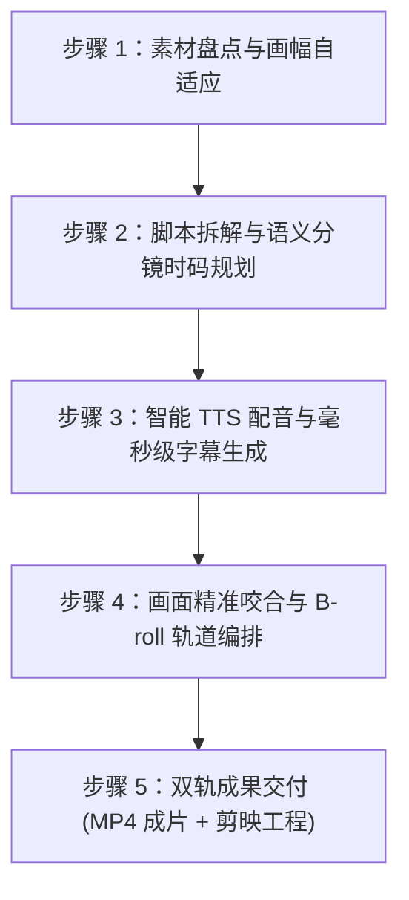

# 全自动短视频剪辑流水线 (AutoVideo-Editor)

本 Skill 将成熟的短视频自动化剪辑全流程固化为标准化生产流水线。无论是口播科普、反差钩子、电商带货还是企业宣传，用户只需提供**文案脚本**与**素材目录**，助手即可自主串联 `workbuddy-chat-cut` 与本地剪辑引擎，完成一键全自动剪辑并交付双重成果（MP4成片 + 剪映可编辑工程）。

---

## 🎯 触发场景与关键词

当用户提出以下任一意图时加载本 Skill：
- **触发词**：`全自动剪辑`、`自动剪视频`、`按脚本剪辑`、`一键成片`、`图文成片`、`做短视频`、`脚本转视频`、`短视频流水线`、`/auto-video-editor`
- **典型输入**：
  - 用户上传了口播脚本文本（如：“根据这段文案帮我剪辑一条30秒短视频...”）
  - 用户指定了本地素材文件夹（如：“素材在 D:\视频素材 目录下，帮我自动合成...”）

---

## 📋 输入参数契约 (Inputs)

启动本技能时，助手需从对话或附件中解析以下三项核心要素：

| 参数项 | 是否必填 | 默认值 | 说明 |
|---|---|---|---|
| **口播脚本 (Script)** | **必填** | 无 | 短视频完整文案，包含分段台词，可自带时码建议或由系统自动估算 |
| **素材目录 (Assets Dir)** | **必填** | 无 | 本地存放实拍视频（.mp4/.mov）或高清图片（.png/.jpg）的文件夹绝对路径 |
| **画幅比例 (Aspect Ratio)** | 选填 | `9:16` (1080×1920) | 竖屏短视频（抖音/视频号/快手）默认为 9:16；横屏科普支持 16:9 (1920×1080) |
| **配音音色倾向 (Voice Preset)** | 选填 | `中文青年/解说风` | 支持指定音色风格（如激昂带货、沉稳解说、亲切叙事）及语速（1.0x-1.15x） |
| **字幕样式 (Subtitle Style)** | 选填 | `中英双语 / 醒目黄色关键词` | 生成带时间戳的 .srt 字幕并压制到画面安全区下1/3处 |

---

## 🛠️ 标准执行流水线 (5-Step Execution Workflow)



### 步骤 1：素材盘点与画幅自适应
1. **递归读取素材库**：扫描用户提供的素材目录，检索所有视频与图片文件。
2. **元数据萃取**：分析每个素材的分辨率、宽高比、帧率和持续时长。
3. **竖屏 9:16 规整化**：
   - 若素材本身为竖屏（如 720×1280、1080×1920），直接裁切居中适配；
   - 若包含横屏素材，自动采用“背景高斯模糊垫底 + 主体画面居中”或“关键区域动态缩放 (Ken Burns)”方案，杜绝生硬黑边。

### 步骤 2：脚本拆解与语义分镜时码规划
1. **结构化拆解**：按照经典短视频黄金结构分解文案：
   - `[00:00-00:05]` **黄金前3秒钩子 (Hook)**：抛出反常识问题或强视觉冲击；
   - `[00:05-00:15]` **认知重塑 / 痛点剖析**：打破常规，引出核心主体；
   - `[00:15-00:30]` **硬核过程 / 价值呈现**：展示实操、生产或技术细节；
   - `[00:30-00:40]` **升华金句 / 行动号召 (CTA)**：一句话总结，引导互动与关注。
2. **时码粗排**：根据标准语速（约 4.5 字/秒）估算各镜头基准时长。

### 步骤 3：智能 TTS 配音与毫秒级字幕生成
1. **调用音频接口**：通过 `workbuddy-chat-cut` 中的语音引擎（或接入 ChatCut Voice）生成高保真口播音频 `voiceover.mp3`。
2. **提取对齐字幕**：
   - 提取音频的字级/词级时间戳，生成 `subtitles.srt`；
   - 自动排查并剔除 ASR 误识别的多余环境乱字；
   - 双语对齐或关键词高亮处理。

### 步骤 4：画面精准咬合与 B-roll 轨道编排
1. **时间线编排**：
   - 主轨道（V1）：放置各分镜匹配的实拍片段；
   - 辅轨道（A1）：放置生成的 TTS 口播主干；
   - 字幕轨（T1）：绑定精确对齐的字幕条。
2. **视觉节奏处理**：
   - 每个画面切换点自动附带轻微淡入淡出（如 6~8 帧 cross-fade）；
   - 实拍视频原有现场杂音默认静音（或保留不超过 10% 作为氛围底噪），避免污染口播音色。

### 步骤 5：双轨成果交付 (MP4 成片 + 剪映工程)
1. **渲染导出**：
   - 成片规格：1080×1920 @ 30fps，H.264 编码，高码率 MP4；
   - 本地存放路径：默认输出在素材目录下或指定产物目录。
2. **工程草稿同步**：
   - 自动生成剪映专业版草稿：`%LOCALAPPDATA%\JianyingPro\User Data\Projects\com.lveditor.draft\<项目名>\draft_content.json`；
   - 用户打开剪映 Desktop 即可二次拖拽微调、换音色或添加专有贴纸！

---

## 💡 最佳使用模板 (User Prompt Templates)

下次用户使用时，只需在 WorkBuddy 对话框输入以下模板即可一键触发：

```markdown
@全自动短视频剪辑流水线 (auto-video-editor)
我有一批新视频素材，请帮我全自动完成配音、双语字幕、镜头匹配和视频导出！

【文案脚本】
你吃过醋，但你吃过“醋做的粉”吗？
很多人第一次听说醋粉，都以为它是面皮换了个名字。错——醋粉跟面皮，从根上就不一样。
醋粉的核心原料，叫醋糟。就是酿醋的时候，粮食发酵完剩下的那部分。别小看它，这里面还留着粮食发酵产生的多种氨基酸、膳食纤维和风味物质。
我们把这些醋糟，经过压榨、过滤、沉淀，把里面剩下的淀粉提出来，再蒸制成型，就成了这一碗筋道爽滑的醋粉。
一句话总结：粮食酿了醋，醋糟做了粉，一粒粮食都不浪费。
想知道醋粉怎么吃才对？关注我，下条视频教你。

【素材目录】
D:\醋粉视频素材\

【剪辑要求】
1. 画幅：9:16 竖屏（1080×1920）
2. 配音：成熟稳重男声/纪录片解说风格，语速适中
3. 字幕：中英双语对齐，关键文字醒目标注
4. 交付：输出 MP4 高清成片以及剪映草稿工程
```

---

## 🛡️ 质量保障守则 (Quality Gates)

1. **绝对禁忌**：严禁横竖屏混剪拉伸变形，必须做自适应填充；
2. **音画严丝合缝**：画面切点必须精准卡在口播断句气口处，严禁口播未完画面黑屏；
3. **杂音净化**：原始实拍素材的环境风噪、杂谈必须默认静音；
4. **可回溯与可再编辑**：每次产出必须附带工程文件，保证用户拥有一键二次修改的自主权。
